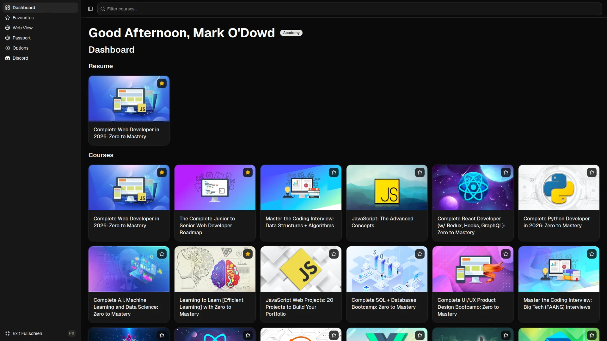

# ZTM Desktop Application

A desktop application for [ZTM Academy](https://zerotomastery.io/), built with
Tauri, React and TypeScript.

It brings your ZTM courses into a dedicated app so you can get back to learning
without hunting through browser tabs:

- **Dashboard**: a personalised greeting, a **Resume** section to pick up where
  you left off, and a grid of all your courses.
- **Course filter**: quickly find a course from the search bar.
- **Favourites**: star courses to keep them close at hand.
- **Web View**: open Academy pages in an embedded view inside the app.
- **Passport**: quick access to your ZTM Passport.
- **Discord**: jump straight to the ZTM community.
- **Options** and **fullscreen** mode (toggle with <kbd>F11</kbd>).

## Getting Started

See [CONTRIBUTING.md](CONTRIBUTING.md) for setup and how to run the app.

## Discord

The Discord sidebar button and keyboard shortcut try the Discord app first, then
the default browser. If both launch attempts fail, a dismissible error is shown.
Once a launch is accepted, the desktop app cannot detect loading failures inside
Discord or the external browser.

## Web View

If the embedded Web View cannot open, a dismissible error dialog with a **Try
again** button is shown, including on the Academy sign-in screen. Retrying opens
the same page. Browser preview uses the same dialog design to explain that Web
View requires the desktop app. After dismissing either message, use **Web View
unavailable** to reopen it.

Opening the app directly at `http://localhost:1420/` in a browser also shows a
matching, dismissible dialog explaining that course loading requires the desktop
app. Use **Course loading unavailable** on the Dashboard to reopen that message.
Browser warnings show the developer launch command only in development builds.
Course loading and update failures also use a dismissible dialog with **Retry**;
saved courses remain available when an update fails.

## License

This project is licensed under the [MIT License](LICENSE).
